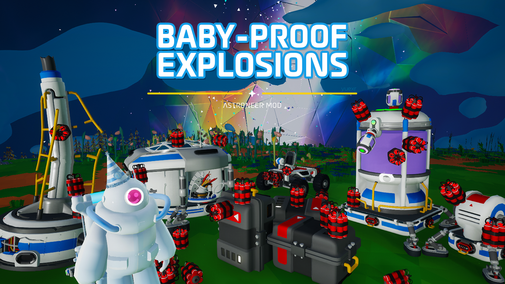
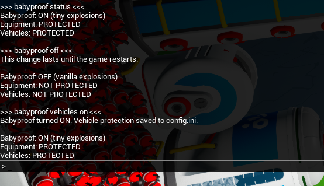

# Baby-Proof Explosions 1.4.0

Makes all explosions (from dynamites, gas, flora, etc.) tiny with negligible blast force that effectively do not damage terrain or players. Equipment is protected from the game's direct explosion-destruction checks.

EXO caches and supported debris are still destroyable and release intended objects. Vehicle protection can be toggled in game. Dynamite must be directly attached to the item intended to break.


## Install

> [!NOTE]  
> The mod folder & files retain the `BabyProofDynamites` name for compatibility with previous versions.

- **(RECOMMENDED)** Install with [Nexus Mods Vortex](https://www.nexusmods.com/vortex), which automatically installs required extensions for Astroneer mods.
- Manual installation:
    1. Download the latest [UE4SS experimental .zip file](https://github.com/UE4SS-RE/RE-UE4SS/releases/tag/experimental-latest) (scroll to the bottom under assets).
    2. In Steam, right-click Astroneer → Manage → Browse local files. Open `Astro\Binaries\Win64`.
    3. Extract the UE4SS .zip content into `Astro\Binaries\Win64`.
    4. Extract the mod's zip `Baby-Proof-Explosions-#.#.#.zip` into `Astro\Binaries\Win64\ue4ss\Mods`.
    5. It should look something like this: `ASTRONEER\Astro\Binaries\Win64\ue4ss\Mods\BabyProofDynamites`.

The mod writes `BabyProofDynamites-status.txt` in its `Scripts` folder. Look for **ACTIVE**. If it says INACTIVE, the message explains why it couldn't load.


## Baby-Proof Explosions Controls

Baby-Proof Explosions always defaults to ON upon every game launch.  
Vehicle protection defaults to ON and remembers your last setting.

**(RECOMMENDED) In-game console toggle:** 

Press F10 (or tilde key) once to open the console input field or twice to see the full console.
Selection & changes apply immediately in-game.

Available commands:

```
babyproof                  shows all commands

babyproof status           reports current protection status
babyproof on               enables safe explosions
babyproof off              restores vanilla explosions (DANGEROUS)

babyproof vehicles on      vehicles are safe & protected from explosives!
babyproof vehicles off     vehicles can be destroyed by attached explosives

babyproof v on/off         v can be used as alias for vehicles
```
*All commands also report current protection status.*

Tips & notes:
- Protection always resets to `babyproof ON` upon every game launch.
- `babyproof ON` restores full protection, and also overwrites vehicle protection status by turning `babyproof vehicles ON`. This is a safety feature!
- Vehicle protection is saved automatically when changed and carries over between sessions. Check status if unsure!

> [!IMPORTANT]  
> Please ensure the explosive is directly attached to the vehicle and not storage.  
> Due to an asset indestructible flag, rail cars and engines must be packaged with a packager first to be destroyed (same as vanilla). Attach dynamite directly to package with vehicle protection off.



## Manual Toggle for Vehicles

Optional. Deprecated, but still works.  
In-game commands are recommended.

Go to `\Astro\Binaries\Win64\ue4ss\Mods\BabyProofDynamites\config.ini`:
```ini
[Explosions]
ProtectVehicles=true
```
- `true` (default): vehicles protected from all explosions
- `false`: vehicle destruction allowed

Game must be restarted for selection to apply.


## Something didn't work?

Send me `Scripts/BabyProofDynamites-events.txt` with what you tried, what you expected and what happened (screenshots optional but will help). The file is included and starts empty. The mod logs each check for explosion destruction.


---


Inspired by [Anti Grief Mod by Colson](https://atenfyr.com/ams-archive/mod?mod=WeakDynamiteMod.Colson).
